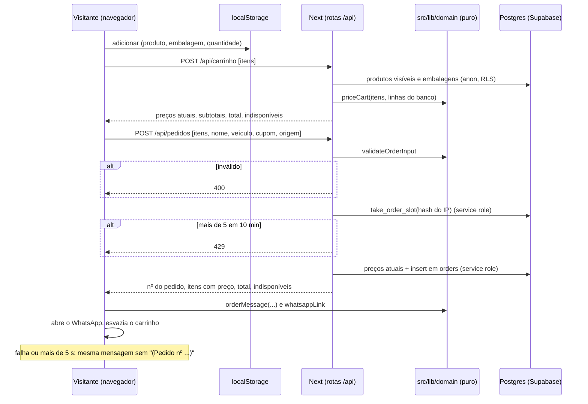

# Carrinho e pedido pelo WhatsApp Design

**Spec**: `.specs/features/carrinho-pedidos/spec.md`
**Status**: Approved (2026-10-28, junto com tasks.md - user: "aprovado, pode seguir")

---

## Approach

| Opção | Como funciona | Prós | Contras |
| --- | --- | --- | --- |
| **A. Carrinho no navegador, preço e pedido em rotas do servidor sobre funções puras (recomendada)** | O carrinho guarda só produto, embalagem e quantidade no `localStorage`. `/carrinho` pede os preços atuais a `POST /api/carrinho`; "Enviar pedido" chama `POST /api/pedidos`, que valida, aplica o limite por IP no Postgres, recalcula os preços do banco e grava o pedido com a chave de serviço. A mensagem do WhatsApp é montada por uma função pura, a mesma no envio e no plano B sem número | O preço nunca vem do navegador (spec, Assumptions); as regras de preço, mensagem, validação e carrinho rodam em `src/lib/domain` com Vitest (AD-011); o limite por IP vale entre instâncias da Vercel porque mora no banco | Duas rotas novas; a chave de serviço passa a ser usada pelo app (só no servidor) |
| B. Server Actions para cotar e enviar | As mesmas regras, chamadas por Server Actions a partir da página | Menos código de rota | Ações do Next não dão o status 429 e 400 que a spec pede (CART-04 AC 7 e 9) e não aceitam o tempo limite de 5 s do lado do navegador com a mesma clareza |
| C. Função do Postgres chamada direto pelo navegador | O navegador chama uma RPC pública que calcula e grava | Sem rota no Next | A RPC pública com a chave anônima fura o limite por IP (o banco não vê o IP real atrás do PostgREST) e abre a gravação de pedidos para qualquer script |

Escolhemos **A**.

## Architecture Overview



**Onde as regras rodam.** Somar o mesmo item, limite de 99, contador, validade de 7 dias, preço de cada item com oferta, total, itens indisponíveis, texto da mensagem, validação de nome, veículo e tamanho do carrinho, filtro de pedidos por status: funções puras em `src/lib/domain`, com Vitest. O limite de 5 pedidos por IP em 10 minutos é uma função do Postgres (`take_order_slot`), com teste de banco. A leitura de pedidos só por admin já é do RLS (teste existente em `tests/db/rls.test.ts`).

---

## Code Reuse Analysis

| Component | Location | How to Use |
| --- | --- | --- |
| `variantPrice`, `CATALOG_SELECT`, `toCatalogItem` | `src/lib/domain/catalog.ts` | Preço de cada embalagem com a oferta e leitura dos produtos |
| `formatBRL` | `src/lib/domain/money.ts` | Valores da mensagem ("1.234,56") e da tela |
| `productTitle` | `src/lib/domain/admin-products.ts` | "<marca> <nome>" na mensagem e no carrinho |
| `whatsappLink`, `withDefaults` | `settings-input.ts`, `site-settings.ts` | Link `https://wa.me/55<número>?text=` |
| `loadSettings`, `loadCoupon` | `src/lib/data/public.ts` | Número da loja e cupom ativo em `/carrinho` |
| `ProductCard`, `PurchaseBox`, `SiteHeader`, `CART_SOON` | `src/components/site` | Os botões que hoje mostram o aviso passam a adicionar; a sacola ganha o contador |
| `RowToggle` (padrão de gravação otimista), `PageHeader` | `src/components/admin`, painel | Lista de pedidos e troca de status |
| Seed, `refreshSite`, `seedSite` | `scripts/local-supabase`, `tests/e2e/support` | e2e |

### Integration Points

| System | Integration Method |
| --- | --- |
| Supabase (leitura de preços) | Cliente anônimo de `src/lib/supabase/public.ts`; o RLS esconde o produto oculto, que vira "Indisponível" |
| Supabase (gravação do pedido e limite) | Cliente com `SUPABASE_SERVICE_ROLE_KEY`, novo `src/lib/supabase/service.ts` com `import "server-only"`; só as duas rotas usam |
| WhatsApp | Link `wa.me` aberto numa aba que o clique já abriu (bloqueador de pop-up); o botão "Abrir o WhatsApp de novo" fica na página |
| Painel | `/admin/pedidos` troca a tela "Nenhum pedido ainda." pela lista; o cartão "Pedidos · 30 dias" já conta da tabela `orders` |

---

## Components

### Domínio (`src/lib/domain`)

- `cart.ts`: `CartLine` (`productId`, `slug`, `title`, `label`, `qty`), `CART_MAX_QTY = 99`, `CART_TTL_DAYS = 7`, `addToCart(cart, line)` (soma no mesmo produto e embalagem, até 99), `setQty`, `removeLine`, `cartCount`, `readCart(raw, now)` (JSON inválido ou mais de 7 dias desde `updatedAt` dá carrinho vazio), `writeCart(cart, now)`.
- `order.ts`: `priceCart(lines, rows)` (preço atual de cada linha com `variantPrice`; produto ausente ou embalagem que sumiu vira indisponível; subtotal e total), `unavailableNotice(n)` ("1 item indisponível ficou de fora." / "2 itens indisponíveis ficaram de fora."), `validateOrderInput(body)` (até 30 itens, quantidade inteira de 1 a 99, nome até 80 e veículo até 40, com a mensagem da spec), `orderMessage({ number?, items, total, name, vehicle, coupon })` com o "Modelo da mensagem" exato.
- `admin-orders.ts`: `ORDER_STATUSES`, `filterOrders(orders, status)`, `orderItemsSummary`.

### Banco (`supabase/migrations/20261029000100_order_throttle.sql`)

- Tabela `order_throttle (key text, created_at timestamptz)` com RLS ligado e nenhuma política (só o service role escreve).
- Função `take_order_slot(p_key text) returns boolean`, `security definer`, executável só pelo `service_role`: apaga as linhas com mais de 10 minutos, conta as da chave e, com menos de 5, grava uma e devolve `true`.
- A chave é o HMAC-SHA256 do IP com o segredo do servidor: o banco nunca guarda o IP, e a linha some em 10 minutos. O pedido não guarda IP nem a chave (CART-04 AC 11).

### Rotas (`src/app/api`)

- `carrinho/route.ts` (`POST`): recebe as linhas, lê produtos visíveis com as embalagens e devolve `priceCart`.
- `pedidos/route.ts` (`POST`): `validateOrderInput` (400 com a mensagem), `take_order_slot` (429), `priceCart` com o banco, sem itens indisponíveis; carrinho só com indisponíveis dá 400; grava `orders` (`items` com título, embalagem, quantidade e preço; `total_estimated`; nome; veículo; `coupon_code` só se a caixa veio marcada e o código é o do cupom ativo; `status` "Novo"; `source_url`) e devolve o número, os itens e o total.

### Site (`src/components/site`)

- `CartProvider` (cliente, no layout `(site)`): estado do carrinho, leitura e gravação no `localStorage` com `try/catch`; sem armazenamento, guarda em memória durante a visita (CART-01 AC 10).
- `SiteHeader`: a sacola mostra `cartCount` num selo; some com o carrinho vazio.
- `ProductCard` ("+") e `PurchaseBox` ("Adicionar ao carrinho"): adicionam e mostram "Adicionado ao carrinho" com o link "Ver carrinho" no lugar de `CART_SOON`.
- `CartView` (cliente, `/carrinho`): lista com quantidade, "Remover", subtotal, total estimado, aviso de preço, "Indisponível", caixa do cupom, nome e veículo, "Enviar pedido pelo WhatsApp" (desativado durante o envio), tempo limite de 5 s, "Pedido enviado! Termine a conversa no WhatsApp.", "Abrir o WhatsApp de novo" e as mensagens de erro da spec.

### Páginas

- `(site)/carrinho/page.tsx`: estática com `revalidate = 60`; o servidor passa o WhatsApp das configurações e o cupom ativo; o resto é `CartView`.
- `admin/(painel)/pedidos/page.tsx`: lista do mais novo ao mais antigo, abas de status, seletor de status por pedido com Server Action `setOrderStatus` e `requireAdmin`.

---

## Data Models

Sem coluna nova em `orders`. Formato de `orders.items`:

```typescript
type OrderItem = { productId: string; title: string; label: string; qty: number; price: number; subtotal: number };
```

Carrinho no `localStorage` (chave `faclub:carrinho`):

```typescript
type StoredCart = { version: 1; updatedAt: string; lines: { productId: string; slug: string; title: string; label: string; qty: number }[] };
```

---

## Error Handling Strategy

| Error Scenario | Handling | User Impact |
| --- | --- | --- |
| Corpo inválido no envio | 400 com a mensagem | "Use até 80 caracteres no nome e 40 no veículo." ou "Não foi possível enviar o pedido." |
| Mais de 5 envios em 10 min | 429 | "Muitos pedidos seguidos. Espere alguns minutos ou fale direto no WhatsApp." |
| Gravação falha ou passa de 5 s | `AbortController`; a página monta a mensagem com a última cotação | WhatsApp abre com a mesma mensagem sem "(Pedido nº ...)" |
| Cotação falha ao abrir `/carrinho` | Itens com o último preço conhecido e aviso "Não foi possível atualizar os preços." | Envio continua possível; o servidor recalcula |
| Navegador bloqueia o pop-up | A aba aberta no clique recebe o link; sem aba, a página navega para o link | O botão "Abrir o WhatsApp de novo" fica à vista |
| `localStorage` bloqueado | Estado em memória | Carrinho dura a visita |

---

## Risks & Concerns

| Concern | Location (file:line) | Impact | Mitigation |
| --- | --- | --- | --- |
| Chave de serviço no app | `src/lib/supabase/service.ts` | Vazar a chave dá acesso total ao banco | `import "server-only"`; só as duas rotas importam; variável sem `NEXT_PUBLIC_` |
| Limite por IP guarda um dado ligado ao visitante | `order_throttle` | LGPD | Só o HMAC do IP, apagado em 10 minutos; a política de privacidade ganha uma frase sobre isso |
| IP atrás do proxy da Vercel | `pedidos/route.ts` | Todos com o mesmo IP | Usa o primeiro valor de `x-forwarded-for` (a Vercel o define); local sem o cabeçalho usa "local" |
| Pop-up bloqueado depois de `await` | `CartView` | WhatsApp não abre | Abre `about:blank` no clique e troca o endereço depois; botão de reabrir |
| Seed e e2e com o limite por IP | e2e | Testes na mesma máquina somam envios | O seed esvazia `order_throttle` |

---

## Tech Decisions (only non-obvious ones)

| Decision | Choice | Rationale |
| --- | --- | --- |
| Onde o preço do pedido é calculado | No servidor, com o banco, por `priceCart` | Spec, Assumptions: preço do navegador pode estar velho ou adulterado |
| Gravação do pedido | Rota com a chave de serviço, sem política de insert para anon | Ninguém grava pedido sem passar pela validação e pelo limite |
| Limite por IP | Tabela + função no Postgres | Vale entre instâncias; memória do servidor não vale na Vercel |
| Cupom no pedido | O servidor só grava `coupon_code` se a caixa veio marcada e o código é o do cupom ativo | Não gravar código inventado |
| Texto "N item(ns)" | Singular e plural de verdade | Mais legível que os parênteses da spec; mesmo sentido |
