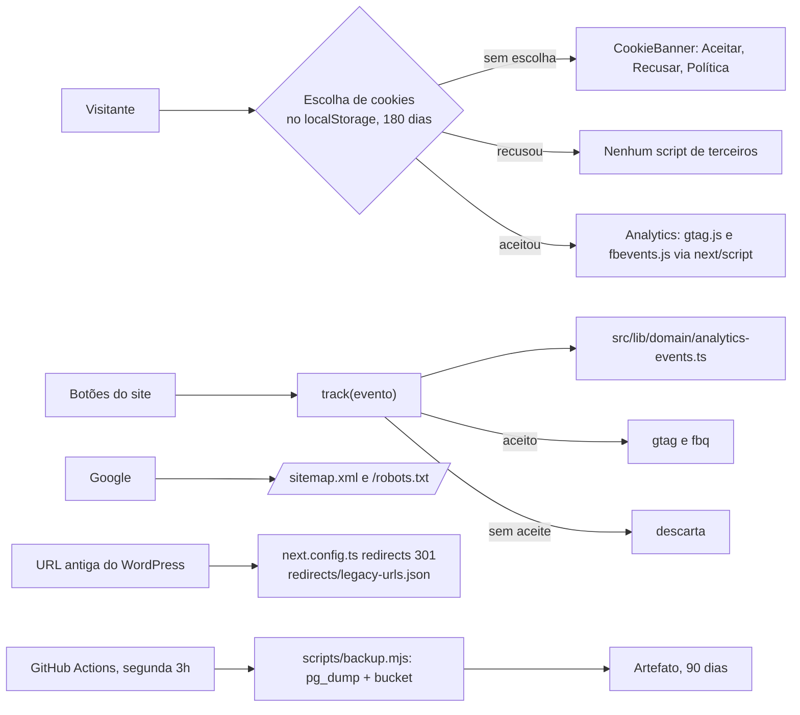

# Lançamento: medição, SEO técnico e backup Design

**Spec**: `.specs/features/lancamento/spec.md`
**Status**: Approved (2026-10-28, junto com tasks.md - user: "aprovado, pode seguir")

---

## Approach

| Opção | Como funciona | Prós | Contras |
| --- | --- | --- | --- |
| **A. Consentimento e eventos no próprio código, sem gerenciador de tags (recomendada)** | O aceite fica no `localStorage` por 180 dias. Só depois dele um componente do layout injeta o `gtag.js` (GA4) e o `fbevents.js` (Pixel) com `next/script`. Cada evento é montado por uma função pura e enviado por `track()`, que não faz nada sem aceite. Sitemap, robots e JSON-LD saem dos arquivos de metadados do Next. Os redirecionamentos vêm de um JSON versionado lido pelo `next.config.ts`, com status 301. O backup é um script Node rodado por um GitHub Actions semanal | Nada de terceiros carrega sem aceite (LGPD); eventos e JSON-LD testados com Vitest (AD-011); o e2e confere a rede e os eventos; os redirecionamentos não passam por código a cada visita | Novos eventos pedem código (não um clique no GTM) |
| B. Google Tag Manager com modo de consentimento | Um contêiner GTM carrega GA4 e Pixel | A Onbind mexe nos eventos sem deploy | O GTM carrega antes do aceite; regras de evento fora do repositório e sem teste |
| C. Backup pelo plano pago do Supabase | Backups diários do próprio Supabase | Zero código | Fora do plano gratuito (AD-001); não guarda o bucket |

Escolhemos **A**.

## Architecture Overview



**Onde as regras rodam.** Validade da escolha (180 dias), conteúdo de cada evento, JSON-LD (incluindo os horários "7h às 18h" em `openingHoursSpecification`), lista de URLs do sitemap e a tradução da lista de URLs antigas em redirecionamentos: funções puras em `src/lib/domain`, com Vitest. Carregar ou não os scripts e enviar ou não um evento depende de uma só função, `canTrack(consent)`, também pura.

---

## Code Reuse Analysis

| Component | Location | How to Use |
| --- | --- | --- |
| Padrão de store com `useSyncExternalStore` e armazenamento bloqueado | `src/components/site/CartProvider.tsx` | `ConsentProvider` usa o mesmo desenho |
| `loadSettings`, `loadVisibleProducts`, `loadProductBySlug`, `splitAddress`, `productTitle`, `variantPrice` | `src/lib/data/public.ts`, domínio | JSON-LD, sitemap e eventos |
| `SiteFooter`, `SiteHeader`, `HomeHero`, `HomeServices`, `HomeContact`, `CatalogBrowser`, `CouponBlock`, `PurchaseBox`, `ProductCard`, `CartView` | `src/components/site` | Pontos de evento |
| `pageMetadata`, `NEXT_PUBLIC_SITE_URL` | `src/lib/seo.ts`, `config.mjs` | URLs absolutas do sitemap e do JSON-LD |
| Stack local, gateway e seed | `scripts/local-supabase` | e2e e teste do backup (o gateway ganha a listagem do bucket) |

### Integration Points

| System | Integration Method |
| --- | --- |
| GA4 | `https://www.googletagmanager.com/gtag/js?id=<NEXT_PUBLIC_GA4_ID>`; eventos por `gtag("event", nome, parâmetros)` |
| Meta Pixel | `https://connect.facebook.net/en_US/fbevents.js`; `fbq("init", id)`, `PageView` e `fbq("trackCustom", nome, parâmetros)` com os mesmos nomes do GA4 |
| Google | `/sitemap.xml` e `/robots.txt` (arquivos `sitemap.ts` e `robots.ts` do App Router) |
| WordPress antigo | 13 URLs do `wp-sitemap.xml` do faclubrificantes.com.br, lidas em 2026-10-28 |
| GitHub Actions | `.github/workflows/backup.yml` com os segredos `SUPABASE_DB_URL`, `SUPABASE_URL` e `SUPABASE_SERVICE_ROLE_KEY` |

---

## Components

### Domínio (`src/lib/domain`)

- `consent.ts`: `ConsentChoice` ("aceito" | "recusado"), `CONSENT_DAYS = 180`, `readConsent(raw, now)` (vencida ou inválida dá "sem escolha"), `writeConsent(choice, now)`, `canTrack(consent)`.
- `analytics-events.ts`: `viewItemEvent(product)`, `addToCartEvent(line, price)`, `sendOrderEvent(items, total)`, `clickWhatsappEvent(location)`, `copyCouponEvent(code)`, `joinGroupEvent()`, cada um devolvendo `{ name, params }`; `WHATSAPP_LOCATIONS` (topo, banner, serviços, contato, catálogo vazio).
- `structured-data.ts`: `localBusinessJsonLd(settings, siteUrl)` (`AutoRepair`, endereço, telefone, horários de seg a sex e sábado) e `productJsonLd(product, siteUrl)` (`Product` com marca, imagem, SKU e `Offer` em BRL, `InStock` ou `OutOfStock`); `parseHours("7h às 18h")` dá `07:00` e `18:00`.
- `sitemap.ts`: `sitemapEntries(siteUrl, products, now)` com a Home, `/produtos`, `/politica-de-privacidade` e cada produto visível com `updated_at`.
- `legacy-redirects.ts`: `buildRedirects(list)` gera as entradas do `next.config.ts` com `statusCode: 301`, com e sem a barra final; mais as regras gerais `/wp-content/*`, `/wp-admin/*`, `/feed/*` para a Home.

### Site (`src/components/site`)

- `ConsentProvider.tsx`: store da escolha (`useConsent`, `acceptCookies`, `rejectCookies`, `reopenCookies`); com armazenamento bloqueado, a escolha vale só na visita e o aviso volta na próxima.
- `CookieBanner.tsx`: aviso fixo no pé da tela com "Aceitar", "Recusar" e "Política de privacidade".
- `Analytics.tsx`: com aceite e ID, injeta os scripts e os stubs `gtag`/`fbq`; `track.ts` exporta `track(event)`.
- `TrackedLink.tsx`: `<a>` que envia `click_whatsapp` com o local antes de abrir o WhatsApp.
- `SiteFooter`: link "Preferências de cookies" nas duas formas do rodapé.

### Páginas e configuração

- `src/app/sitemap.ts`, `src/app/robots.ts`.
- `<script type="application/ld+json">` na Home e na página do produto.
- `redirects/legacy-urls.json` (versionado) lido pelo `next.config.ts`; `/contato` passa de 308 para 301.

### Backup

- `scripts/backup.mjs`: `pg_dump --schema=public` (estrutura e dados), `pg_dump --data-only` de `auth.users` e `auth.identities` (logins do painel), e cópia de todos os objetos do bucket `product-images` pela API do Storage; tudo numa pasta com data.
- `.github/workflows/backup.yml`: `cron: "0 6 * * 1"` (segunda 3h em Brasília, UTC-3 sem horário de verão), `workflow_dispatch` para rodar à mão, cliente `pg_dump` 17, `actions/upload-artifact` com `retention-days: 90`. Uma falha deixa o job vermelho, e o GitHub manda e-mail a quem cuida do agendamento (padrão das notificações de Actions).
- O gateway do Supabase local ganha `POST /storage/v1/object/list/:bucket` para o teste do backup.

---

## Data Models

Sem tabela nova. Escolha de cookies no `localStorage` (chave `faclub:cookies`):

```typescript
type StoredConsent = { version: 1; choice: "aceito" | "recusado"; at: string };
```

`redirects/legacy-urls.json`:

```json
[{ "from": "/a-empresa/", "to": "/" }, { "from": "/contato/", "to": "/#contato" }]
```

---

## Error Handling Strategy

| Error Scenario | Handling | User Impact |
| --- | --- | --- |
| ID do GA4 ou do Pixel vazio | O script correspondente não carrega; `track` só manda para o que carregou | Nenhum |
| `localStorage` bloqueado | Escolha só na visita; aviso volta | Nada carrega sem aceite |
| Bloqueador de anúncios derruba o script | `gtag` e `fbq` são filas; nada quebra | Site segue normal |
| `pg_dump` ou cópia do bucket falham | Script sai com erro; job vermelho | E-mail do GitHub para quem cuida do repositório |

---

## Risks & Concerns

| Concern | Location (file:line) | Impact | Mitigation |
| --- | --- | --- | --- |
| Lista de URLs antigas incompleta | `redirects/legacy-urls.json` | Link antigo fora do sitemap cai em 404 | A lista vem do `wp-sitemap.xml`; antes de trocar o DNS a Onbind confere o relatório de páginas do Search Console e acrescenta o que faltar (mesmo arquivo, mesmo teste) |
| Next responde 308 em `permanent: true` | `next.config.ts` | Spec pede 301 | `statusCode: 301` em cada entrada (documentado no `redirects` do Next) |
| Barra final das URLs do WordPress (`/contato/`) | `next.config.ts` | O Next tira a barra com 308 antes do redirecionamento | Entrada para as duas formas; o e2e confere que `/contato/` dá 301 direto |
| Versão do `pg_dump` | workflow | Dump falha com servidor mais novo | Cliente 17 do repositório do PostgreSQL; o Supabase novo roda 15 ou 17 |
| Push de `.github/workflows` | git | O token pode não ter permissão de workflow | Se o push for recusado, o arquivo fica pronto e a Onbind o envia |
| Backup não roda aqui | Actions | Não dá para provar o agendamento neste ambiente | Teste de configuração do YAML + o script rodado contra o Supabase local com restauração |
| `NEXT_PUBLIC_SITE_URL` em produção | Vercel | Sitemap e JSON-LD com host errado | Variável obrigatória na lista de lançamento |

---

## Tech Decisions (only non-obvious ones)

| Decision | Choice | Rationale |
| --- | --- | --- |
| Nomes no Pixel | `trackCustom` com os mesmos 6 nomes do GA4 | Uma lista só de eventos; a Onbind mapeia para eventos padrão no Gerenciador da Meta se quiser |
| `click_whatsapp` | Um `TrackedLink` com o local ("topo", "banner", "servicos", "contato", "catalogo_vazio") | Spec, CONS-01 AC 8: o local do botão |
| Destino das URLs antigas | `/a-empresa/`, `/about/` e posts para a Home; `/servicos/` e `/services/` para `/#servicos`; `/contato/` para `/#contato`; categorias, `style_category` e autor para a Home | Não há página nova equivalente além dessas seções |
| Backup de usuários | Só `auth.users` e `auth.identities` | São os logins do painel; o resto do `auth` é recriado pelo Supabase |
