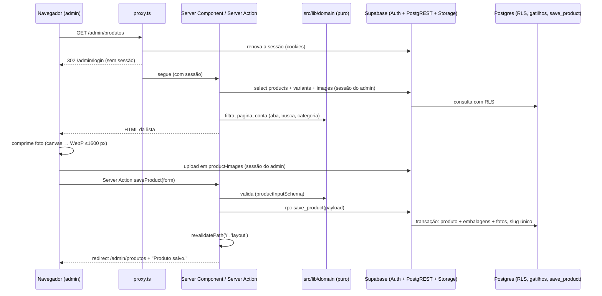

# Painel: login e catálogo Design

**Spec**: `.specs/features/painel-catalogo/spec.md`
**Status**: Approved

---

## Approach

Três caminhos entregam o mesmo escopo:

| Opção | Como funciona | Prós | Contras |
| --- | --- | --- | --- |
| **A. Server Components + Server Actions, RLS como autoridade (recomendada)** | Páginas do painel renderizam no servidor com o cliente Supabase da sessão do admin; gravações passam por Server Actions que chamam o Supabase com a mesma sessão; integridade em funções e gatilhos do Postgres; regras de exibição em módulos TypeScript puros | Uma só fonte de verdade de segurança (RLS); regras testáveis sem navegador; mesma stack das páginas públicas | Exige montar um Supabase local para os testes de ponta a ponta |
| B. Painel SPA no navegador falando direto com o Supabase | Componentes cliente chamam `supabase-js` do navegador; o servidor só entrega HTML | Menos código de servidor | Validação espalhada no navegador; regras de lista sem camada testável; mais JS no celular da loja |
| C. Framework de admin pronto (Refine, react-admin) | CRUD gerado a partir das tabelas | CRUD rápido | Difícil chegar nas capturas e no celular; mais uma dependência grande para a loja depender |

Escolhemos **A**: mantém o RLS como única barreira de segurança, deixa filtros, busca e contagens em código testado (Critical Rule 6) e serve de base para as features seguintes.

## Architecture Overview



**Onde as regras rodam.** Filtro por aba, busca, filtro de categoria, paginação, selo de estoque, contagens dos cartões e preço exibido rodam em `src/lib/domain/*`, funções puras testadas pelo Vitest. Integridade (preço promocional menor que o preço, uma só capa, oferta exige preço promocional, slug único, exclusão bloqueada com produtos) roda no Postgres, testada contra um Postgres local. A interface só mostra o que essas camadas devolvem.

---

## Code Reuse Analysis

### Existing Components to Leverage

| Component | Location | How to Use |
| --- | --- | --- |
| Nenhum código de aplicação | - | O repositório só tem README; esta feature cria a base |
| Protótipo aprovado | `docs/referencias/prototipo.html` | Fonte dos tokens de cor, tipografia e espaçamentos das telas do painel |
| `@supabase/ssr` | npm | Cliente Supabase com cookies para Server Components, Server Actions e `proxy.ts` |
| `next/font/google` | Next.js | Inter (texto) e Inter Tight (títulos), as fontes do protótipo |

### Integration Points

| System | Integration Method |
| --- | --- |
| Supabase Auth | E-mail e senha; papel em `app_metadata.role` (só o service role escreve ali) |
| Supabase Postgres | Tabelas do PRD seção 7 com RLS; função `save_product(jsonb)` com `security invoker` |
| Supabase Storage | Bucket público `product-images`; escrita só para admin, por política em `storage.objects` |
| Site público (features seguintes) | `revalidatePath('/', 'layout')` depois de cada gravação |

---

## Components

### Banco (migrações)

- **Purpose**: Esquema completo do MVP, RLS, bucket e regras de integridade.
- **Location**: `supabase/migrations/`
- **Interfaces**:
  - `public.is_admin(): boolean` - `auth.jwt() -> 'app_metadata' ->> 'role' = 'admin'`
  - `public.make_slug(text): text` - minúsculas, sem acento (`unaccent`), hífens
  - `public.save_product(p jsonb): uuid` - grava produto, embalagens e fotos numa transação; slug único com sufixo `-2`, `-3`
  - gatilho `products_promo_guard` - recusa `is_promo = true` sem preço promocional em alguma embalagem (erro `P0001`, mensagem `promo_requires_price`)
  - gatilhos de exclusão em `categories` e `brands` - recusam com `category_in_use:N` / `brand_in_use:N`
- **Dependencies**: extensões `unaccent` e `pgcrypto`
- **Reuses**: modelo de dados do PRD seção 7, com AD-009

### Domínio (`src/lib/domain`)

- **Purpose**: Regras puras que mudam o que a loja vê.
- **Location**: `src/lib/domain/`
- **Interfaces**:
  - `normalizeSearch(text: string): string` e `matchesSearch(haystack: string[], query: string): boolean` - sem maiúsculas, acentos, hífens ou espaços internos; todas as palavras da busca precisam aparecer (reaproveitado pelo catálogo público)
  - `parseBRL(input: string): number | null` e `formatBRL(value: number): string` - "R$ 1.234,56"
  - `productInputSchema` (zod) - campos obrigatórios e mensagens exatas da spec
  - `filterAdminProducts(rows, { tab, query, categoryId, page }): { items, total, page, pages, label }`
  - `adminKpis(rows, ordersLast30: number): { active, promo, lowStock, orders30 }`
  - `stockLabel(stock: number): { text: string; low: boolean }` - limite 5
  - `displayVariant(product): { label: string; price: number; promoPrice: number | null }` - primeira embalagem, "N embalagens"
  - `acceptPhoto(file: {type, size}, currentCount: number): { ok: true } | { ok: false; message: string }`
  - `resizeTarget(width, height, max = 1600): { width, height }`
  - `nextCover(photos, removedId): photos` - capa na primeira restante
- **Dependencies**: `zod`
- **Reuses**: -

### Supabase (`src/lib/supabase`)

- **Purpose**: Clientes e guarda de acesso.
- **Location**: `src/lib/supabase/`
- **Interfaces**:
  - `createServerSupabase(): SupabaseClient` - cookies do Next
  - `createBrowserSupabase(): SupabaseClient` - upload de fotos
  - `requireAdmin(): Promise<User>` - redireciona para `/admin/login` sem sessão; encerra a sessão e redireciona com `?erro=sem-permissao` sem papel admin
- **Dependencies**: `@supabase/ssr`, `@supabase/supabase-js`

### `src/proxy.ts`

- **Purpose**: Renova a sessão e manda para `/admin/login` quem abre `/admin/*` sem sessão.
- **Interfaces**: `proxy(request)`, `config.matcher = ['/admin/:path*']`, exceto `/admin/login`, `/admin/esqueci-senha`, `/admin/nova-senha` e `/admin/auth/callback`

### Telas de acesso (`src/app/admin/(acesso)`)

- **Purpose**: Login, esqueci a senha, nova senha e callback do link do e-mail.
- **Interfaces**: actions `signIn(formData)`, `requestReset(formData)`, `setNewPassword(formData)`, `signOut()`; rota `auth/callback` troca o código PKCE por sessão

### Shell do painel (`src/components/admin/AdminShell.tsx`)

- **Purpose**: Menu lateral escuro da captura, com os 8 itens na ordem de AD-007, usuário e "Sair"; vira barra superior com menu no celular.
- **Reuses**: tokens de `src/app/globals.css`

### Lista de produtos (`src/app/admin/(painel)/produtos/page.tsx`)

- **Purpose**: Cartões, abas, busca, filtro, tabela (cartões no celular), paginação, estados vazios.
- **Interfaces**: lê `searchParams` (`aba`, `q`, `categoria`, `pagina`); chama `filterAdminProducts` e `adminKpis`
- **Subcomponentes**: `KpiCards`, `ProductFilters` (cliente, atualiza a URL sem recarregar), `ProductsTable`, `Switch`

### Interruptores (`src/components/admin/RowToggle.tsx` + `src/app/admin/(painel)/produtos/actions.ts`)

- **Purpose**: Liga e desliga `is_visible` e `is_promo` com atualização otimista; volta e mostra a mensagem quando a action falha.
- **Interfaces**: `setVisibility(id, value)`, `setPromo(id, value)` → `{ ok: true } | { ok: false; message }`

### Formulário de produto (`src/components/admin/product-form/`)

- **Purpose**: Formulário da captura de cadastro, para novo, edição e cópia.
- **Subcomponentes**: `ProductForm` (estado, validação, Cancelar com confirmação), `PhotoUploader` (comprime e envia, capa, remover, até 6), `VariantPicker` (chips e preço por embalagem, AD-003), `PreviewCard` (prévia ao vivo), `BrandQuickCreate` ("+ Nova marca")
- **Interfaces**: `ProductForm({ initial, brands, categories, onSave, onCreateBrand })`; `saveProduct(input)` action → `{ ok: true } | { ok: false; fieldErrors }`
- **Reuses**: `productInputSchema`, `acceptPhoto`, `resizeTarget`, `nextCover`, `displayVariant`

### Categorias e marcas (`src/app/admin/(painel)/categorias`, `.../marcas`)

- **Purpose**: Listas com contagem de produtos, criar, renomear, ordenar (categorias) e excluir com bloqueio.
- **Interfaces**: actions `saveCategory`, `moveCategory(id, 'up' | 'down')`, `deleteCategory`, `saveBrand`, `deleteBrand`

---

## Data Models

Tabelas do PRD seção 7, com estas definições:

```sql
categories      (id uuid pk, slug text unique, name text, position int, unique(lower(name)))
brands          (id uuid pk, slug text unique, name text, logo_path text null, unique(lower(name)))
products        (id uuid pk, slug text unique, name text, brand_id uuid fk restrict, category_id uuid fk restrict,
                 description text, is_visible bool, is_promo bool, is_featured bool, sku text null,
                 specs jsonb {viscosity, type: 'Mineral'|'Semissintético'|'Sintético'|null, api, application},
                 stock int check (stock >= 0), created_at, updated_at)
product_variants(id uuid pk, product_id fk cascade, label text, price numeric(10,2) check (price > 0),
                 promo_price numeric(10,2) null check (promo_price > 0 and promo_price < price), position int)
product_images  (id uuid pk, product_id fk cascade, path text, position int, is_cover bool,
                 unique index (product_id) where is_cover)
orders          (id bigint identity pk, items jsonb, total_estimated numeric(10,2), customer_name text null,
                 vehicle text null, coupon_code text null, status text check in ('Novo','Atendido','Cancelado'),
                 source_url text null, created_at)
coupons, banners, settings - conforme PRD; settings com check (id = 1)
```

**Relationships**: produto pertence a uma marca e uma categoria; tem 1 ou mais embalagens e 1 a 6 fotos. `products.price` e `products.promo_price` do PRD não existem: o preço mora só nas embalagens (AD-009).

**RLS**: `anon` e `authenticated` leem produtos visíveis (e suas embalagens e fotos), categorias, marcas, banners ativos, cupons ativos e settings; `is_admin()` lê e escreve tudo; `anon` não lê `orders`. A inserção em `orders` vem em carrinho-pedidos.

---

## Error Handling Strategy

| Error Scenario | Handling | User Impact |
| --- | --- | --- |
| Senha errada | `signInWithPassword` devolve erro; a action devolve a mensagem da spec | "E-mail ou senha incorretos.", e-mail mantido |
| Usuário sem papel admin | `requireAdmin` encerra a sessão | Login com "Este acesso não tem permissão para o painel." |
| Oferta sem preço promocional | Gatilho recusa; a action traduz `promo_requires_price` | Interruptor volta, mensagem da spec |
| Falha de rede ou banco num interruptor | A action devolve `{ ok: false }` | Interruptor volta, "Não foi possível salvar. Tente de novo." |
| Validação do formulário | `productInputSchema` no cliente e de novo na action | "Campo obrigatório" e as demais mensagens por campo |
| Upload de foto falha | O `PhotoUploader` marca a foto | "Falhou · tentar de novo" só naquela foto |
| Excluir categoria ou marca em uso | Gatilho recusa com a contagem | "Esta categoria tem N produtos..." |
| Sessão expirada no formulário | A action devolve `401`; o formulário guarda o rascunho em `sessionStorage` e volta a ele depois do login | Dados preservados |

---

## Risks & Concerns

| Concern | Location (file:line) | Impact | Mitigation |
| --- | --- | --- | --- |
| Sem Docker com imagens do Supabase neste ambiente (ECR bloqueado, Docker Hub com 429) | ambiente | `supabase start` não roda; testes não teriam banco real | Postgres 16 local + PostgREST e Supabase Auth (GoTrue) em binários + gateway Node com Storage simulado (AD-010); o CI do GitHub roda o mesmo script |
| O Storage dos testes é simulado | `scripts/local-supabase/gateway.mjs` | Política do bucket não exercitada pelo e2e | Políticas de `storage.objects` testadas direto no Postgres com o esquema `storage` mínimo; teste manual no Supabase real antes do lançamento |
| Fotos órfãs no bucket quando o admin cancela | `PhotoUploader` | Ocupa espaço no plano gratuito (1 GB) | Fotos vão para `products/<id>/`; limpeza de órfãs fica como tarefa de manutenção na feature lancamento |
| HEIC no Chrome do computador | `PhotoUploader` | O canvas não lê HEIC fora do Safari | `heic2any` carregado só quando chega um HEIC |
| Dois admins editando o mesmo produto | `save_product` | A última gravação vence | Aceito na spec (Edge Cases) |
| Cadastro de contas admin depende da Onbind | Supabase | A loja não cria usuários | Script `scripts/create-admin.mjs` com service role, rodado pela Onbind |

---

## Tech Decisions (only non-obvious ones)

| Decision | Choice | Rationale |
| --- | --- | --- |
| Proteção de rotas | `src/proxy.ts` (Next 16 renomeou `middleware` para `proxy`) mais `requireAdmin()` no layout | Docs do Next 16.4 instalados; checagem dupla |
| Revalidação | `revalidatePath('/', 'layout')` depois de cada gravação | O catálogo é pequeno; revalidar tudo evita esquecer uma rota |
| Id do produto novo | Gerado no navegador (`crypto.randomUUID()`) | As fotos sobem antes de o produto existir, já na pasta certa |
| "Visão geral" no menu | `/admin` redireciona para `/admin/produtos` | Os cartões de indicadores moram na lista; nenhuma spec pede outra tela |
| "Pedidos" no menu | Página mínima com "Nenhum pedido ainda." até carrinho-pedidos | AD-007; a lista completa é ORD-01 |
| Banners, Cupons, Configurações no menu | Links para páginas que painel-conteudo entrega; até lá mostram "Em breve" | A captura desenha os itens |
| Testes de componente | Vitest + Testing Library em jsdom, com as actions passadas por props | Prova validação e mensagens sem servidor |
| Versões | next 16.4.3, react 19.3, @supabase/ssr 0.12.7, @supabase/supabase-js 2.118.0, tailwindcss 4.3.3, zod 4.6, vitest 5.0, @playwright/test 1.63.0 | Últimas estáveis no npm em 2026-10-28; Playwright fixo em 1.63.0, a versão do Chromium já instalado no ambiente |
