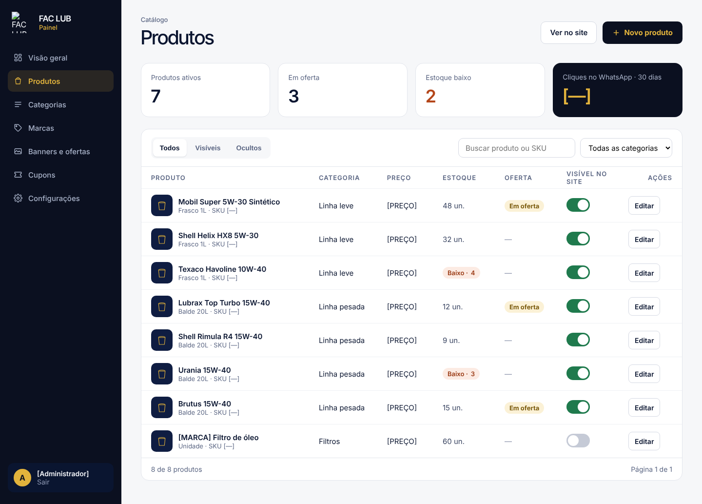
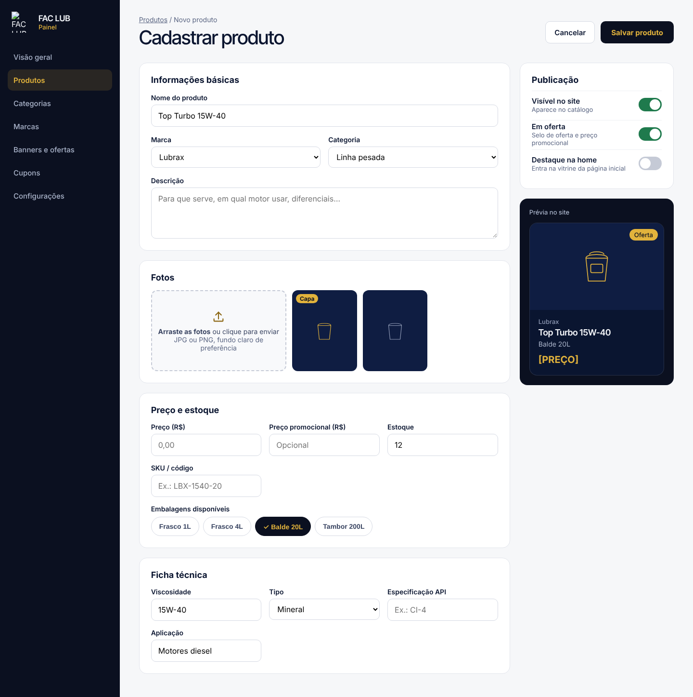

# Painel: login e catálogo Specification

**Approved**: 2026-10-28 - user: "ok para todas as recomendações, pode seguir"

## Problem Statement

Hoje a loja não tem como publicar ou atualizar produtos sem depender da Onbind. O site atual não tem catálogo e as ofertas vivem só no Instagram e no WhatsApp. Esta feature entrega o painel em `/admin` onde 1 ou 2 pessoas da loja, sem perfil técnico, entram com e-mail e senha e cadastram produtos, categorias e marcas pelo celular. Vem primeiro no cronograma para a loja já cadastrar enquanto o site público é montado (AD-002).

## Goals

- [ ] A pessoa da loja publica um produto novo em menos de 5 minutos, sem ajuda (meta do PRD, seção 2)
- [ ] Preço, oferta e visibilidade mudam direto na lista, sem abrir o produto
- [ ] Nenhum visitante sem login consegue ler ou alterar dado do painel

## Out of Scope

| Feature | Reason |
| --- | --- |
| Vários usuários com níveis de permissão | PRD seção 4: fica para a V2 |
| Tela para criar contas de administrador | Contas são criadas pela Onbind no Supabase (ver Assumptions) |
| Banners, cupons e configurações da loja | Feature painel-conteudo |
| Lista de pedidos | Feature carrinho-pedidos |
| Importar produtos por CSV (RF30) | Could; fica fora do MVP |
| Baixa automática de estoque por pedido | PRD seção 4: fica para a V2; o estoque é só informativo |
| Excluir produto definitivamente | Ocultar cobre a necessidade e não quebra links nem pedidos antigos (ver Assumptions) |

---

## Assumptions & Open Questions

| Assumption / decision | Chosen default | Rationale | Confirmed? |
| --- | --- | --- | --- |
| Como alguém vira administrador | Conta criada no Supabase Auth com `app_metadata.role = "admin"`; a primeira é contato@onbind.com.br | PRD: acesso ao painel por contato@onbind.com.br; sem tela de gestão de usuários no MVP | y |
| Recuperação de senha | Link "Esqueci minha senha" envia e-mail do Supabase Auth com link para `/admin/nova-senha` | RF16; usa o fluxo nativo do Supabase | y |
| Limite de estoque baixo | Estoque de 5 unidades ou menos mostra o selo "Baixo · N" | A captura mostra "Baixo · 4" e "Baixo · 3" e "9 un." sem selo; 5 separa os dois | y |
| Itens por página na lista | 20 produtos por página | A captura mostra "Página 1 de 1" com 8 itens; 20 cabe numa tela de notebook | y |
| Slug do produto | Gerado do nome (minúsculo, sem acento, hífens); se já existir, recebe sufixo `-2`, `-3` | Mantém URLs legíveis para SEO | y |
| Compressão das fotos | No navegador, antes do envio: lado maior até 1600 px, convertida para WebP com qualidade 0,8 | RF20 e US05: foto de celular chega grande; WebP atende o requisito de performance | y |
| Formatos de foto aceitos | JPG, PNG, WebP e HEIC até 15 MB cada | A captura diz "JPG ou PNG"; HEIC é o padrão do iPhone e chega do celular da loja | y |
| Excluir produto | Não existe; o produto é ocultado | Pedidos antigos guardam o nome do item; ocultar é reversível | y |
| Categorias iniciais | Linha leve, Linha pesada, Filtros, Aditivos e graxas | PRD seção 7 | y |
| Marcas iniciais | Mobil, Shell, Texaco, Lubrax, Urania, Brutus | PRD seção 7 | y |
| Embalagens oferecidas no cadastro | Frasco 1L, Frasco 4L, Balde 20L, Tambor 200L e "Unidade"; a loja pode digitar outra | A captura desenha as quatro primeiras; filtros e graxas usam "Unidade" e "Pote 500g" no catálogo | y |
| Q1: cada embalagem tem preço próprio? | Sim: cada embalagem marcada ganha os campos Preço e Preço promocional (AD-003) | user: "ok para todas as recomendações, pode seguir"; a página do produto troca de embalagem e a tabela `product_variants` do PRD tem preço por embalagem | y |

**Open questions:** none - Q1, Q5, Q6 e Q7 respondidas em 2026-10-28 (user: "ok para todas as recomendações, pode seguir"), registradas em AD-003, AD-006, AD-007 e AD-008.

---

## User Stories

### P1: Entrar no painel ⭐ MVP

**User Story**: Como administrador da loja, quero entrar com e-mail e senha para que só a loja mexa no catálogo.

**Why P1**: Sem login não há painel; é a barreira de segurança de tudo o que vem depois.

**Acceptance Criteria**:

1. WHEN um visitante sem sessão abre qualquer rota sob `/admin` THEN o sistema SHALL redirecionar para `/admin/login`
2. WHEN o administrador envia e-mail e senha corretos THEN o sistema SHALL abrir `/admin/produtos`
3. IF o e-mail ou a senha estiverem errados THEN o sistema SHALL mostrar "E-mail ou senha incorretos." e manter o e-mail digitado
4. IF um usuário autenticado não tiver `role = "admin"` THEN o sistema SHALL encerrar a sessão e mostrar "Este acesso não tem permissão para o painel."
5. WHEN o administrador usa "Esqueci minha senha" com um e-mail THEN o sistema SHALL mostrar "Se o e-mail estiver cadastrado, você vai receber um link para criar uma nova senha." para qualquer e-mail informado
6. WHEN o administrador abre o link do e-mail e grava uma senha de 8 ou mais caracteres THEN o sistema SHALL abrir `/admin/produtos` já autenticado
7. WHEN o administrador usa "Sair" THEN o sistema SHALL encerrar a sessão e abrir `/admin/login`
8. The sistema SHALL recusar no banco (RLS) qualquer escrita em products, product_images, product_variants, categories e brands feita sem sessão de administrador

**Independent Test**: Abrir `/admin/produtos` sem login cai no login; entrar com a conta admin abre a lista; uma conta sem papel admin é recusada.

---

### P1: Ver e filtrar a lista de produtos ⭐ MVP

**User Story**: Como administrador, quero ver todos os produtos com preço, estoque, oferta e visibilidade para saber o que está no site.

**Why P1**: É a tela que a loja mais usa (US06, RF17).

**Acceptance Criteria**:

1. WHEN o administrador abre `/admin/produtos` THEN o sistema SHALL mostrar a tela em `.specs/features/painel-catalogo/captures/admin-produtos.png`
2. The lista SHALL mostrar por linha: foto de capa, marca e nome, embalagem e SKU, categoria, preço, estoque, oferta, interruptor de visibilidade e o botão "Editar"
3. WHEN o administrador escolhe a aba "Visíveis" THEN a lista SHALL mostrar só produtos com `is_visible = true`
4. WHEN o administrador escolhe a aba "Ocultos" THEN a lista SHALL mostrar só produtos com `is_visible = false`
5. WHEN o administrador digita no campo "Buscar produto ou SKU" THEN a lista SHALL mostrar só produtos cujo nome, marca ou SKU contenham o texto, sem diferenciar maiúsculas, acentos ou hífens
6. WHEN o administrador escolhe uma categoria no filtro THEN a lista SHALL mostrar só produtos dessa categoria, combinada com a aba e a busca
7. WHEN um produto tem estoque de 5 ou menos THEN a coluna Estoque SHALL mostrar o selo "Baixo · N"; acima disso SHALL mostrar "N un."
8. WHEN a lista passa de 20 produtos THEN o sistema SHALL paginar de 20 em 20 e mostrar "X de Y produtos" e "Página A de B"
9. WHEN nenhum produto atende aos filtros THEN a lista SHALL mostrar "Nenhum produto encontrado." e o botão "Limpar filtros"
10. WHEN ainda não existe produto cadastrado THEN a lista SHALL mostrar "Nenhum produto cadastrado ainda." e o botão "Novo produto"
11. WHEN o administrador usa "Ver no site" THEN o sistema SHALL abrir o catálogo público em nova aba
12. The topo SHALL mostrar os cartões "Produtos ativos" (visíveis), "Em oferta" (visíveis com `is_promo`), "Estoque baixo" (estoque de 5 ou menos) e "Pedidos · 30 dias" (linhas de `orders` criadas nos últimos 30 dias), calculados do banco
13. The coluna Oferta SHALL mostrar um interruptor de oferta em cada linha
14. The menu lateral SHALL mostrar, nesta ordem, Visão geral, Produtos, Pedidos, Categorias, Marcas, Banners e ofertas, Cupons e Configurações
15. WHEN a coluna Preço mostra um produto com várias embalagens THEN ela SHALL mostrar o preço da primeira embalagem e a linha de embalagem SHALL dizer "N embalagens"
16. WHEN a largura da janela é menor que 768 px THEN a lista SHALL virar cartões empilhados com os mesmos dados e interruptores, sem rolagem horizontal da página

**Independent Test**: Com 8 produtos de exemplo, cada aba, a busca "15w40" e o filtro "Linha pesada" devolvem as linhas esperadas.

---

### P1: Mudar visibilidade e oferta direto na lista ⭐ MVP

**User Story**: Como administrador, quero ligar e desligar "Visível" e "Em oferta" na própria lista para atualizar a oferta da semana em segundos.

**Why P1**: US06 e RF18 (Must).

**Acceptance Criteria**:

1. WHEN o administrador aciona o interruptor "Visível no site" de uma linha THEN o sistema SHALL gravar o novo `is_visible` sem recarregar a página e manter o interruptor na nova posição
2. WHEN o administrador aciona o interruptor de oferta de uma linha THEN o sistema SHALL gravar o novo `is_promo` sem recarregar a página
3. IF o administrador liga a oferta de um produto sem preço promocional em nenhuma embalagem THEN o sistema SHALL manter a oferta desligada e mostrar "Informe o preço promocional antes de ativar a oferta."
4. IF a gravação falhar THEN o sistema SHALL voltar o interruptor à posição anterior e mostrar "Não foi possível salvar. Tente de novo."

**Independent Test**: Desligar "Visível" de um produto e abrir o catálogo público: o produto sumiu da lista e da busca.

---

### P1: Cadastrar e editar produto ⭐ MVP

**User Story**: Como administrador, quero cadastrar um produto com fotos, preço e embalagens para ele aparecer no site.

**Why P1**: US05, RF19 e RF20 (Must).

**Acceptance Criteria**:

1. WHEN o administrador usa "Novo produto" THEN o sistema SHALL mostrar o formulário em `.specs/features/painel-catalogo/captures/admin-cadastro.png`
2. WHEN o administrador usa "Editar" numa linha THEN o sistema SHALL abrir o mesmo formulário preenchido com os dados do produto
3. IF o administrador usa "Salvar produto" sem nome, marca, categoria, ao menos uma embalagem com preço ou ao menos uma foto THEN o sistema SHALL não salvar e mostrar "Campo obrigatório" abaixo de cada campo que falta
4. IF o preço promocional de uma embalagem for maior ou igual ao preço dela THEN o sistema SHALL não salvar e mostrar "O preço promocional precisa ser menor que o preço."
5. IF preço, preço promocional ou estoque forem negativos ou não numéricos THEN o sistema SHALL não salvar e mostrar "Informe um número válido."
6. WHEN o administrador envia fotos THEN o sistema SHALL reduzir cada uma para no máximo 1600 px no lado maior e converter para WebP antes de enviar ao bucket `product-images`
7. IF o produto já tiver 6 fotos THEN o sistema SHALL recusar novas fotos e mostrar "Máximo de 6 fotos por produto."
8. IF um arquivo não for JPG, PNG, WebP ou HEIC, ou passar de 15 MB THEN o sistema SHALL recusar o arquivo e mostrar "Envie uma foto JPG, PNG, WebP ou HEIC de até 15 MB."
9. WHEN o administrador marca uma foto como capa THEN o sistema SHALL mostrar o selo "Capa" nela e gravar `is_cover = true` só nessa foto
10. WHEN a primeira foto é enviada THEN o sistema SHALL marcá-la como capa
11. WHEN o administrador remove a foto de capa e restam outras THEN o sistema SHALL marcar a primeira restante como capa
12. WHEN o administrador marca uma embalagem THEN o sistema SHALL mostrar os campos Preço (R$) e Preço promocional (R$) daquela embalagem; desmarcar SHALL removê-la do produto
13. WHEN o administrador altera nome, marca, embalagem, preço ou "Em oferta" THEN a "Prévia no site" SHALL mostrar o card com os novos valores sem salvar
14. WHEN o administrador salva um produto válido THEN o sistema SHALL gravar o produto, voltar para `/admin/produtos` e mostrar "Produto salvo."
15. WHEN o administrador liga "Destaque na home" THEN o sistema SHALL gravar `is_featured = true`
16. WHEN o administrador usa "Cancelar" com alterações não salvas THEN o sistema SHALL perguntar "Descartar as alterações?" e só sair se ele confirmar
17. WHEN o administrador salva um produto cujo nome gera o mesmo slug de outro THEN o sistema SHALL gerar o slug com sufixo `-2`, `-3` e assim por diante
18. The campo Tipo da ficha técnica SHALL oferecer Mineral, Semissintético e Sintético
19. WHEN a largura da janela é menor que 768 px THEN o formulário SHALL empilhar as seções em uma coluna com a Publicação logo depois das Informações básicas

**Independent Test**: Cadastrar "Top Turbo 15W-40" com duas fotos tiradas no celular, balde 20L e preço; o produto aparece no catálogo público em até 1 minuto, com a capa escolhida.

---

### P2: Duplicar produto

**User Story**: Como administrador, quero duplicar um produto para cadastrar variações parecidas rápido.

**Why P2**: RF21 (Should); poupa tempo, mas não bloqueia o lançamento.

**Acceptance Criteria**:

1. WHEN o administrador usa "Duplicar" na edição de um produto THEN o sistema SHALL abrir um formulário novo com todos os campos e fotos copiados, nome com " (cópia)" no fim e "Visível no site" desligado
2. WHEN o administrador salva a cópia THEN o sistema SHALL criar um produto novo com slug próprio, sem alterar o original

**Independent Test**: Duplicar o "Delvac 15W-40", trocar a embalagem e salvar: existem dois produtos e o original não mudou.

---

### P1: Cadastrar categorias e marcas ⭐ MVP

**User Story**: Como administrador, quero criar e editar categorias e marcas para organizar o catálogo.

**Why P1**: RF22 (Must); produto exige marca e categoria.

**Acceptance Criteria**:

1. WHEN o administrador abre "Categorias" THEN o sistema SHALL listar as categorias na ordem de `position`, com nome e número de produtos
2. WHEN o administrador cria uma categoria com nome THEN o sistema SHALL gravá-la com slug gerado do nome e no fim da ordem
3. IF o administrador tenta excluir uma categoria com produtos THEN o sistema SHALL não excluir e mostrar "Esta categoria tem N produtos. Mude a categoria deles antes de excluir."
4. IF o nome da categoria ou da marca já existir THEN o sistema SHALL não salvar e mostrar "Já existe uma com esse nome."
5. WHEN o administrador abre "Marcas" THEN o sistema SHALL listar as marcas em ordem alfabética, com nome, logo (quando houver) e número de produtos
6. WHEN o administrador cria uma marca com nome e, opcionalmente, um logo THEN o sistema SHALL gravá-la com slug gerado do nome
7. IF o administrador tenta excluir uma marca com produtos THEN o sistema SHALL não excluir e mostrar "Esta marca tem N produtos. Mude a marca deles antes de excluir."
8. WHEN o administrador usa "+ Nova marca" no formulário de produto THEN o sistema SHALL criar a marca sem sair do formulário e já selecioná-la
9. WHEN o administrador usa "Subir" ou "Descer" numa categoria THEN a lista SHALL mostrar a nova ordem e o sistema SHALL gravar o novo `position`

**Independent Test**: Criar a marca "Ipiranga" pelo formulário de produto e salvar o produto com ela; tentar excluir a marca é recusado.

---

## Edge Cases

- IF a sessão expirar enquanto o formulário está aberto THEN o sistema SHALL manter os dados digitados, pedir login de novo e voltar ao formulário
- IF o envio de uma foto falhar THEN o sistema SHALL marcar só aquela foto com "Falhou · tentar de novo" e manter as outras
- IF dois administradores editarem o mesmo produto ao mesmo tempo THEN a última gravação SHALL prevalecer (sem trava de edição no MVP)
- WHEN um produto está oculto THEN ele SHALL continuar aparecendo no painel, na aba "Ocultos"

---

## Requirement Traceability

| Requirement ID | Story | Phase | Status |
| --- | --- | --- | --- |
| AUTH-01 | P1: Entrar no painel (AC 1-8) | Design | Pending |
| PLIST-01 | P1: Ver e filtrar a lista (AC 1-16) | Design | Pending |
| PTOG-01 | P1: Visibilidade e oferta na lista (AC 1-4) | Design | Pending |
| PFORM-01 | P1: Cadastrar e editar produto (AC 1-19) | Design | Pending |
| PDUP-01 | P2: Duplicar produto (AC 1-2) | Design | Pending |
| TAX-01 | P1: Categorias e marcas (AC 1-9) | Design | Pending |

**Coverage:** 6 total, 0 mapped to tasks, 6 unmapped ⚠️ (tasks vêm depois da aprovação)

Os critérios "aparece no site em até 1 minuto" e "o filtro segue a ordem das categorias" ficam em site-publico CAT-01 (AC 15 a 17): só existe como prová-los quando o site público existir. O painel já chama a revalidação a cada gravação.

PRD coberto aqui: RF16, RF17, RF18, RF19, RF20, RF21, RF22, RF27 (parcial), RF28, RF29, US05, US06.

---

## Differences from the source

| Source shows | Product shows | Confirmed |
| --- | --- | --- |
| Coluna "Oferta" com selo "Em oferta" ou "—" | Interruptor de oferta na coluna, como pede o RF18 | y - AD-006 |
| Menu lateral sem "Pedidos" | Item "Pedidos" logo abaixo de "Produtos" | y - AD-007 |
| Cartão "Cliques no WhatsApp · 30 dias" | Cartão "Pedidos · 30 dias", contado da tabela orders | y - AD-008 |
| Uma única linha de Preço e Preço promocional para o produto | Preço e Preço promocional por embalagem marcada | y - AD-003 |
| Chips de embalagem Frasco 1L, Frasco 4L, Balde 20L e Tambor 200L | Os mesmos, mais "Unidade" e "Outra" (nome livre) | y - AD-013 |
| Menu lateral sem ícones e sem o bloco do usuário em `admin-cadastro.png` (a `admin-produtos.png` desenha os dois) | Ícones e bloco do usuário com "Sair" em todas as telas do painel | y - AD-014 |

## Sources

- `docs/referencias/PRD.md` - escopo, RF16 a RF30, modelo de dados, RLS e decisões
-  - binding - lista de produtos do painel com cartões de indicadores, abas, busca, filtro e tabela (1440 px)
-  - binding - formulário de cadastro com fotos, preço e estoque, embalagens, ficha técnica, publicação e prévia (1440 px)

Os ícones de produto na captura são espaço reservado; as fotos reais vêm da sessão de fotos.

---

## Success Criteria

- [ ] A pessoa da loja cadastra um produto com 2 fotos tiradas no celular em menos de 5 minutos no primeiro teste
- [ ] Um produto salvo como visível aparece no catálogo público em até 1 minuto
- [ ] Uma requisição sem sessão admin não lê nem grava nada do painel (testado contra o RLS)
