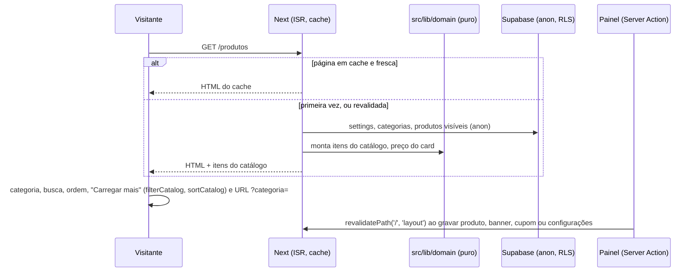

# Site público: Home, Catálogo e Produto Design

**Spec**: `.specs/features/site-publico/spec.md`
**Status**: Approved (2026-10-28, junto com tasks.md - user: "aprovado, pode seguir")

---

## Approach

| Opção | Como funciona | Prós | Contras |
| --- | --- | --- | --- |
| **A. Páginas estáticas com ISR e filtros no navegador sobre funções puras (recomendada)** | Home, catálogo, produto e política são geradas no servidor com um cliente Supabase anônimo (sem cookies), ficam em cache e são revalidadas quando o painel grava (`revalidatePath('/', 'layout')`, já feito) e a cada 60 s como rede de segurança. O catálogo carrega todos os produtos visíveis numa vez e filtra, busca, ordena e pagina no navegador com funções puras de `src/lib/domain` | LCP baixo (HTML pronto no CDN da Vercel); filtro sem recarregar (CAT-01 AC 3); regras testadas pelo Vitest (AD-011); mesma revalidação que o painel já chama | O catálogo inteiro vai no HTML; aceitável até algumas centenas de produtos |
| B. Renderização a cada visita, com filtro no servidor | `searchParams` no servidor e consulta filtrada a cada clique | Lista sempre no momento | Cada filtro vira uma ida ao servidor; LCP pior; plano gratuito do Supabase atende todo visitante |
| C. Páginas montadas no navegador falando com o Supabase | HTML vazio e dados buscados pelo navegador | Simples de cachear | SEO e Open Graph fracos; LCP ruim no 4G |

Escolhemos **A**: atende a meta de LCP e Lighthouse do PRD, a busca roda em código testado e reaproveita o que o painel já faz ao gravar (AD-012).

## Architecture Overview



**Onde as regras rodam.** Busca, filtro por categoria, ordenação, contagem, "Carregar mais", preço do card, banner ativo, cupom ativo, destaques, "Combine com", linhas da ficha técnica, disponibilidade e configurações com valores padrão são funções puras em `src/lib/domain/`. As páginas só mostram o que elas devolvem.

**Falha do Supabase.** Os carregadores de dados lançam erro quando a consulta falha; o Next mantém a última versão gerada da página e tenta de novo na próxima revalidação (Edge Case da spec).

---

## Code Reuse Analysis

| Component | Location | How to Use |
| --- | --- | --- |
| `matchesSearch`, `normalizeSearch` | `src/lib/domain/search.ts` | Busca do catálogo (campos: nome, marca, categoria, viscosidade, aplicação, SKU) |
| `formatBRL` | `src/lib/domain/money.ts` | Preços dos cards e da página do produto |
| `productTitle`, `displayVariant` | `src/lib/domain/admin-products.ts` | Título "Marca Nome" e primeira embalagem |
| `whatsappLink`, `formatPhone`, `DEFAULT_SCHEDULE_MESSAGE` | `src/lib/domain/settings-input.ts` | Botões de WhatsApp e telefone |
| `publicImageUrl` | `src/lib/storage.ts` | Fotos de produto, banner e logo de marca |
| `IconBucket` | `src/components/admin/icons.tsx` | Imagem neutra de produto sem foto |
| Tokens e fontes | `src/app/globals.css`, `layout.tsx` | Mesmo visual do protótipo |
| Seed e stack local | `scripts/local-supabase/` | e2e e capturas |

### Integration Points

| System | Integration Method |
| --- | --- |
| Supabase | Cliente anônimo de servidor (`src/lib/supabase/public.ts`), sem cookies, para as páginas continuarem estáticas; o RLS só deixa ler o que é público |
| Painel | Já chama `revalidatePath('/', 'layout')` em toda gravação |
| Carrinho (feature seguinte) | Ícone de sacola no topo e botão "Adicionar ao carrinho" ficam prontos; o contador e a ação chegam em carrinho-pedidos |
| Revalidação manual | `POST /api/revalidar` com `Authorization: Bearer <REVALIDATE_SECRET>` revalida o site todo; serve à Onbind depois de importar dados direto no banco e aos testes depois do seed |

---

## Components

### Domínio (`src/lib/domain`)

- `site-settings.ts`: `INITIAL_SETTINGS`, `withDefaults(row | null)`, `SITE_MESSAGES` (orçamento "Olá! Quero um orçamento.", contato "Olá! Vim pelo site da FAC LUB."), `scheduleLink(settings)`, `budgetLink`, `contactLink`.
- `catalog.ts`: `CatalogItem`, `toCatalogItem(row)`, `cardPrice(item)` (promo só com oferta ligada), `filterCatalog(items, { category, query })`, `sortCatalog(items, sort)` com `destaques` | `menor-preco` | `maior-preco` | `a-z`, `productCountLabel(n)`, `CATALOG_PAGE = 12`.
- `home.ts`: `activeBanner(banners)` (ativo de menor ordem), `activeCoupon(coupons)`, `couponBadge(coupon)` ("10% OFF · FACLUB10"), `featuredProducts(items)` (até 4).
- `product-page.ts`: `specRows(product)` (esconde campo vazio), `availability(stock)`, `packageCaption(label)` ("à vista · balde 20L"), `relatedProducts(product, items)` (até 4 de outras categorias, destaques primeiro).

### Dados públicos (`src/lib/data/public.ts`, server-only)

`loadSettings()`, `loadHomeData()`, `loadCatalog()` (categorias na ordem + itens visíveis), `loadProductBySlug(slug)`; todos com o cliente anônimo e erro lançado quando a consulta falha.

### Shell do site (`src/app/(site)/layout.tsx`)

- `SiteHeader`: logo, "Serviços" (`/#servicos`), "Produtos", "Contato" (`/#contato`) com o link atual em negrito (`aria-current`), ícone de sacola "Carrinho" para `/carrinho`, "Agendar troca" com `scheduleLink`; fixo no topo (`sticky top-0`); abaixo de 768 px o menu vira um botão "Abrir menu".
- `SiteFooter`: duas formas, como nas capturas. Na Home: logo, "© <ano> FAC Lubrificantes", "Instagram" (só com link), "Produtos", "Política de privacidade", "Área administrativa". Nas demais páginas: "© <ano> FAC Lubrificantes · Parque Novo Mundo, São Paulo", "Política de privacidade" e "Área administrativa". O layout escolhe a forma pela rota (`usePathname`).

**Embalagem marcada na página do produto.** A "primeira embalagem" do PDP-01 AC 5 é a primeira do cadastro (`position`), a mesma que o card mostra; os chips aparecem do menor ao maior (Frasco 1L, Frasco 4L, Balde 20L, Tambor 200L, Unidade, depois as de nome livre). É o que a captura desenha: chips de Frasco 1L a Balde 20L com o Balde 20L marcado, e o card da Home com "Lubrax · Balde 20L".

**"Carregar mais" na captura do catálogo.** A captura mostra "12 produtos" e o botão ao mesmo tempo; o CAT-01 AC 11 só mostra o botão quando há mais produtos que os da tela. Com os 12 produtos de exemplo o botão não aparece, e essa é a única diferença esperada na foto do catálogo.

### Componentes de site (`src/components/site`)

`ProductCard` (selo "Oferta", marca · embalagem, nome, preço com o normal riscado, imagem neutra quando não há foto ou ela não carrega, botão "+" que o carrinho liga depois), `CouponBlock` (copiar com "Copiado" por 2 s, fallback de seleção, grupo em nova aba), `CatalogBrowser` (cliente: chips, busca, ordem, contador, "Carregar mais", vazio), `ProductGallery`, `PurchaseBox` (embalagens, preço, quantidade 1 a 99, "Adicionar ao carrinho"), `MapEmbed` (iframe com `loading="lazy"`).

### Páginas

`(site)/page.tsx` (Home), `(site)/produtos/page.tsx`, `(site)/produtos/[slug]/page.tsx` (`generateStaticParams` + `dynamicParams`, 404 com "Produto não encontrado."), `(site)/politica-de-privacidade/page.tsx`, redirecionamento `/contato` → `/#contato` em `next.config.ts`, `api/revalidar/route.ts`. Cada página exporta `revalidate = 60` e `generateMetadata`.

---

## Data Models

Sem tabela nova. `CatalogItem`:

```typescript
type CatalogItem = {
  id: string; slug: string; name: string; brandName: string;
  categorySlug: string; categoryName: string; sku: string | null;
  viscosity: string; application: string; isPromo: boolean; isFeatured: boolean;
  stock: number; coverPath: string | null; createdAt: string;
  variants: { label: string; price: number; promoPrice: number | null }[];
};
```

---

## Error Handling Strategy

| Error Scenario | Handling | User Impact |
| --- | --- | --- |
| Supabase fora do ar na revalidação | Carregador lança; o Next mantém a página anterior | Vê a última versão |
| `settings` vazia | `withDefaults(null)` devolve `INITIAL_SETTINGS` | Vê os dados iniciais da loja |
| Produto oculto ou slug inexistente | `notFound()` | 404 com "Produto não encontrado." e "Ver todos os produtos" |
| Foto do produto não carrega | `onError` troca pela imagem neutra | Card com o ícone de embalagem |
| Navegador sem permissão de área de transferência | `CouponBlock` seleciona o código | "Selecione e copie o código." |
| `/api/revalidar` sem o segredo certo | 401 | Nada é revalidado |

---

## Risks & Concerns

| Concern | Location (file:line) | Impact | Mitigation |
| --- | --- | --- | --- |
| Páginas pré-geradas no build com o banco do momento | `next build` | No e2e, o build roda antes do seed e as páginas nasceriam vazias | `POST /api/revalidar` depois do seed (helper `refreshSite()` nos testes) |
| Fotos de produto não passam pelo otimizador do Next | `ProductCard`, `ProductGallery` | O otimizador recusa o host local do e2e | As fotos já chegam em WebP de até 1600 px pelo painel; `` com `loading="lazy"`, `width` e `height`; fotos estáticas da Home usam `next/image` |
| Botão "Adicionar ao carrinho" e "+" sem ação nesta entrega | `PurchaseBox`, `ProductCard` | Controle visível que ainda não faz nada | O carrinho é a feature seguinte (AD-002); até lá o botão mostra "O carrinho chega em breve. Peça pelo WhatsApp." |
| Fotos de banco nos serviços | `public/images/home` | Licença | As 5 fotos vêm do protótipo aprovado; os 6 cards de serviço ficam no fundo escuro da captura até a sessão de fotos |
| Catálogo inteiro no HTML | `/produtos` | Página pesada com muitos produtos | Medido no Lighthouse da feature lancamento; com centenas de produtos, passa a paginar no servidor |

---

## Tech Decisions (only non-obvious ones)

| Decision | Choice | Rationale |
| --- | --- | --- |
| Cliente Supabase das páginas públicas | `createClient` anônimo sem cookies | Ler cookies tornaria a página dinâmica e perderia o cache |
| Revalidação | Sob demanda pelo painel + `revalidate = 60` | Garante "em até 1 minuto" mesmo se uma gravação externa não chamar a revalidação |
| Estado do catálogo na URL | `?categoria=`, `?q=`, `?ordem=` com `history.replaceState` | Link compartilhável sem recarregar |
| "+" do card e "Adicionar ao carrinho" | Presentes, com aviso temporário | A spec pede o rótulo (PDP-01 AC 14); a ação é de carrinho-pedidos |
| Seed do site | `seed({ site: true })` com os 12 produtos da captura do catálogo, 4 destaques e um banner | Mantém o seed do painel intacto para os testes dele |
