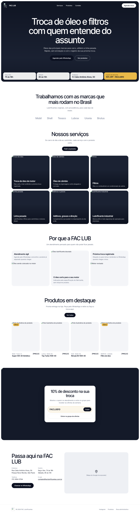
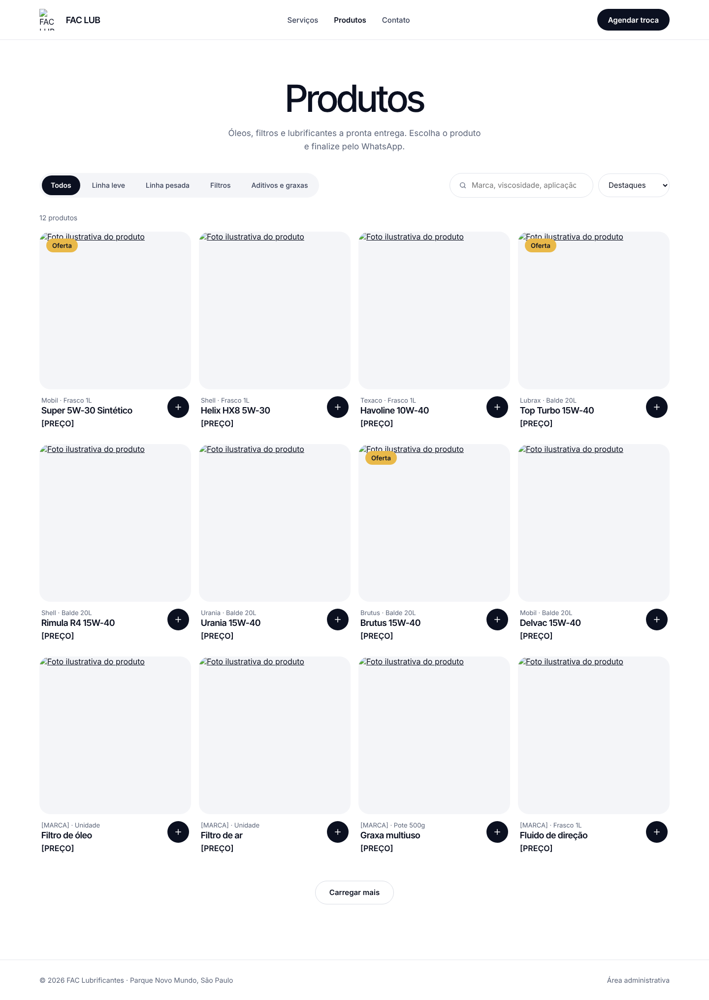
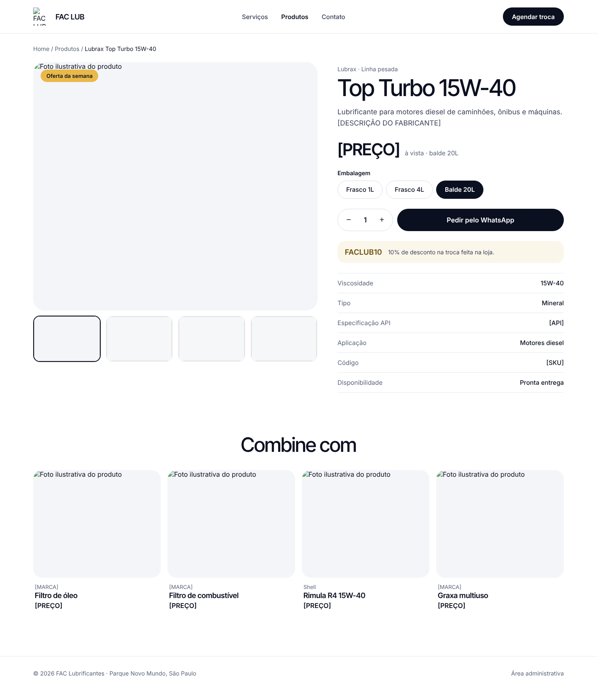

# Site público: Home, Catálogo e Produto Specification

**Approved**: 2026-10-28 - user: "ok para todas as recomendações, pode seguir"

## Problem Statement

O site atual é um WordPress de 2016, sem catálogo, e não ajuda a vender. O motorista quer agendar a troca pelo celular em um toque; o comprador quer achar o óleo certo por marca, viscosidade e embalagem. Esta feature entrega as páginas públicas no visual aprovado no protótipo, lendo produtos, banner, cupom e dados da loja do Supabase.

## Goals

- [ ] O visitante agenda a troca pelo WhatsApp em um toque, de qualquer página
- [ ] O comprador encontra um produto por marca ou viscosidade em uma busca
- [ ] Lighthouse mobile 90 ou mais e LCP abaixo de 2,5 s em 4G nas três páginas

## Out of Scope

| Feature | Reason |
| --- | --- |
| Carrinho, envio do pedido e contador | Feature carrinho-pedidos (o botão de adicionar é ligado lá) |
| GA4, Meta Pixel, aviso de cookies, sitemap, dados estruturados e redirecionamentos 301 | Feature lancamento |
| Pagamento online e frete | PRD seção 4: V2 |
| Agendamento com horário marcado | PRD seção 4: V2 |
| Citar tempo médio da troca | PRD, Decisões: o site não cita tempo de serviço |

---

## Assumptions & Open Questions

| Assumption / decision | Chosen default | Rationale | Confirmed? |
| --- | --- | --- | --- |
| Página de Contato | O item "Contato" do menu leva à seção "Passa aqui na FAC LUB" da Home (`/#contato`); `/contato` redireciona para lá | O protótipo desenha o contato como seção da Home, não como página | y |
| Ordem "Destaques" | Primeiro os produtos com destaque, depois os em oferta, depois A–Z | O PRD não define a ordem | y |
| Preço mostrado no card | Preço da primeira embalagem do produto; em oferta, o preço promocional com o normal riscado | O card da captura mostra uma embalagem e um preço | y |
| Ordenação por preço | Usa o mesmo preço mostrado no card | O cliente vê a lista na ordem do que lê | y |
| Itens por carga no catálogo | 12 produtos; "Carregar mais" traz mais 12 | A captura mostra 12 cards e "Carregar mais" | y |
| "Combine com" na página do produto | Até 4 produtos visíveis de outras categorias, os com destaque primeiro | A captura combina um óleo com filtros e graxa; o PRD não tem campo de relacionados | y |
| Produto sem foto real | Mostra uma imagem neutra com o ícone de embalagem | O cadastro exige foto, mas produtos de banco podem ficar sem até a sessão de fotos | y |
| Fotos de banco até a sessão de fotos | Fotos de banco com licença livre nas seções de serviços e no topo | PRD, Riscos: sem data para a sessão de fotos | y |
| Marcas na Home | Nome em texto, em cinza, como na captura; logo só quando a marca tiver `logo_path` fornecido pelo distribuidor | PRD, Riscos: uso de logos das marcas | y |
| "Pedir orçamento" e "Chamar no WhatsApp" | Abrem o WhatsApp com "Olá! Quero um orçamento." e "Olá! Vim pelo site da FAC LUB." | O PRD só define a mensagem de agendamento | y |
| Mapa | Iframe do Google Maps com o endereço das configurações, carregado só quando a seção entra na tela | RF09 e a meta de LCP | y |
| Larguras | Do 360 px ao 1440 px; no celular o catálogo mostra 2 cards por linha | PRD seção 8; a captura do catálogo só existe em 1440 px | y |
| Q2: botão principal da página do produto | "Adicionar ao carrinho" no lugar de "Pedir pelo WhatsApp" (AD-004) | user: "ok para todas as recomendações, pode seguir"; o PRD (US03) manda montar o carrinho antes de enviar | y |
| Q3: contador do carrinho no topo | Ícone de sacola com o número de itens, entre o menu e "Agendar troca", e "Política de privacidade" no rodapé (AD-005) | user: "ok para todas as recomendações, pode seguir"; RF11 e RF10 | y |
| Q4: botão fixo de WhatsApp | O topo fica fixo ao rolar e o "Agendar troca" cumpre o RF06; sem botão flutuante | user: "ok para todas as recomendações, pode seguir"; a captura não desenha botão flutuante | y |
| Q10: textos "registro da sua próxima troca" e "lembrete no WhatsApp" | Mantidos como no protótipo | user: "ok para todas as recomendações, pode seguir"; a recomendação mantinha o texto se a loja faz a etiqueta e o lembrete à mão, e o protótipo foi aprovado pela loja; o site não automatiza o lembrete (V2) | y |

**Open questions:** none - Q2, Q3, Q4 e Q10 respondidas em 2026-10-28 (user: "ok para todas as recomendações, pode seguir"), registradas em AD-004 e AD-005.

---

## User Stories

### P1: Agendar a troca em um toque ⭐ MVP

**User Story**: Como motorista, quero chamar a loja no WhatsApp em um toque para agendar a troca sem ligar.

**Why P1**: US01, RF06 (Must); é a conversão principal do motorista.

**Acceptance Criteria**:

1. The topo de todas as páginas públicas SHALL mostrar o botão "Agendar troca", visível no celular de 360 px sem rolar
2. WHILE o visitante rola qualquer página pública o topo SHALL ficar fixo no alto da tela
3. WHEN o visitante usa "Agendar troca" ou "Agendar pelo WhatsApp" THEN o sistema SHALL abrir `https://wa.me/55<WhatsApp das configurações>` com a mensagem de agendamento das configurações já escrita
4. The topo SHALL ter os links "Serviços", "Produtos" e "Contato", e o link da página atual SHALL aparecer em negrito
5. WHEN a largura da janela é menor que 768 px THEN os links do menu SHALL ficar num menu aberto por um botão com o rótulo acessível "Abrir menu", e "Agendar troca" SHALL continuar à vista
6. The topo SHALL mostrar o ícone de sacola com o rótulo acessível "Carrinho", entre o menu e "Agendar troca", levando a `/carrinho`

**Independent Test**: No celular de 360 px, em qualquer página, um toque em "Agendar troca" abre o WhatsApp com a mensagem pronta.

---

### P1: Ver a Home ⭐ MVP

**User Story**: Como visitante, quero ver na Home os serviços, as marcas, os produtos em destaque, o cupom e o contato para decidir vir à loja.

**Why P1**: RF01, RF09 (Must).

**Acceptance Criteria**:

1. WHEN o visitante abre `/` THEN o sistema SHALL mostrar a página em `.specs/features/site-publico/captures/home.png`
2. The topo da Home SHALL mostrar título, texto, foto e link do banner ativo; sem banner ativo SHALL mostrar "Troca de óleo e filtros com quem entende do assunto" com o texto e a foto padrão
3. The faixa abaixo do topo SHALL mostrar os horários e o endereço das configurações e o cupom ativo como "10% OFF · FACLUB10"
4. The seção de marcas SHALL listar as marcas cadastradas
5. The seção "Produtos em destaque" SHALL mostrar até 4 produtos visíveis com `is_featured = true`; sem nenhum, SHALL esconder a seção
6. WHEN o visitante usa "Ver produtos" ou "Ver todos" THEN o sistema SHALL abrir `/produtos`
7. WHEN o visitante usa o card de um produto THEN o sistema SHALL abrir a página daquele produto
8. The seção "Passa aqui na FAC LUB" SHALL mostrar endereço, horários, telefone e e-mail das configurações e o mapa do Google com o endereço
9. WHEN o visitante usa o telefone THEN o sistema SHALL abrir `tel:` com o número; WHEN usa o e-mail THEN SHALL abrir `mailto:`
10. The rodapé SHALL mostrar "© <ano atual> FAC Lubrificantes" e os links "Instagram", "Produtos", "Política de privacidade" e "Área administrativa"
11. WHERE o link do Instagram ou do grupo estiver vazio nas configurações o sistema SHALL esconder o botão correspondente
12. WHEN o administrador salva um banner, o cupom ou as configurações no painel THEN a Home SHALL mostrar a mudança em até 1 minuto
13. WHEN o administrador desativa o único banner ativo THEN a Home SHALL mostrar o topo padrão em até 1 minuto
14. IF não houver cupom ativo THEN a Home e a página do produto SHALL esconder os blocos de cupom
15. WHEN o administrador muda o WhatsApp nas configurações THEN todos os botões de WhatsApp do site SHALL usar o novo número em até 1 minuto

**Independent Test**: Abrir `/` com os dados de exemplo e comparar com a captura; trocar o horário no painel e ver a Home mudar.

---

### P2: Copiar o cupom e entrar no grupo

**User Story**: Como cliente, quero copiar o FACLUB10 e entrar no grupo de ofertas.

**Why P2**: US04, RF07, RF08 (Should).

**Acceptance Criteria**:

1. WHEN o visitante usa "Copiar" no bloco do cupom THEN o sistema SHALL copiar o código para a área de transferência e trocar o rótulo do botão para "Copiado" por 2 segundos
2. IF o navegador não permitir copiar THEN o sistema SHALL selecionar o código na tela e mostrar "Selecione e copie o código."
3. The bloco do cupom SHALL mostrar o texto "Mostre o cupom no atendimento e entre no grupo para receber as ofertas da semana." e deixar claro que o desconto vale só para serviços feitos na loja
4. WHEN o visitante usa "Entrar no grupo de ofertas" THEN o sistema SHALL abrir o link do grupo das configurações em nova aba

**Independent Test**: Tocar em "Copiar" e colar em outro app: aparece FACLUB10.

---

### P1: Encontrar o produto no catálogo ⭐ MVP

**User Story**: Como comprador, quero filtrar por categoria e buscar por marca ou viscosidade para achar o produto certo.

**Why P1**: US02, RF02, RF03, RF05 (Must).

**Acceptance Criteria**:

1. WHEN o visitante abre `/produtos` THEN o sistema SHALL mostrar a página em `.specs/features/site-publico/captures/catalogo.png`
2. The catálogo SHALL listar só produtos com `is_visible = true`
3. WHEN o visitante escolhe uma categoria THEN a lista SHALL mostrar só os produtos dela, sem recarregar a página, e a URL SHALL ganhar `?categoria=<slug>`
4. WHEN o visitante abre `/produtos?categoria=<slug>` THEN o sistema SHALL abrir o catálogo já filtrado por aquela categoria
5. WHEN o visitante digita "15w40", "15W-40", "15w 40" ou "15W40" THEN a busca SHALL encontrar os mesmos produtos de viscosidade 15W-40
6. WHEN o visitante digita "lubrax", "LUBRAX" ou "Lubrax" THEN a busca SHALL encontrar os mesmos produtos da marca Lubrax
7. WHEN o visitante digita "oleo" ou "óleo" THEN a busca SHALL encontrar os mesmos produtos
8. WHEN a busca tem várias palavras THEN a lista SHALL mostrar só produtos que contenham todas elas, em qualquer ordem, entre nome, marca, categoria, viscosidade, aplicação e SKU
9. WHEN o visitante escolhe "Menor preço", "Maior preço", "A–Z" ou "Destaques" THEN a lista SHALL seguir essa ordem, combinada com a categoria e a busca
10. The contador acima da lista SHALL mostrar "N produtos" com o total que atende aos filtros, e "1 produto" no singular
11. WHEN existem mais produtos que os mostrados THEN o sistema SHALL mostrar "Carregar mais"; WHEN o visitante usa o botão THEN SHALL acrescentar os próximos 12
12. WHEN nenhum produto atende aos filtros THEN o sistema SHALL mostrar "Nenhum produto encontrado. Tente outra busca ou fale com a gente no WhatsApp." e o botão "Chamar no WhatsApp"
13. WHERE um produto está em oferta o card SHALL mostrar o selo "Oferta" e o preço promocional ao lado do preço normal riscado
14. The card SHALL mostrar marca, embalagem, nome e preço em reais no formato "R$ 1.234,56"
15. WHEN o administrador salva um produto com "Visível no site" ligado THEN o produto SHALL aparecer no catálogo público em até 1 minuto
16. WHEN o administrador muda visibilidade, oferta ou preço de um produto THEN o catálogo, a página do produto e a Home SHALL mostrar a mudança em até 1 minuto
17. WHEN o administrador muda a ordem das categorias no painel THEN o filtro do catálogo SHALL seguir a nova ordem

**Independent Test**: Com os 12 produtos de exemplo, "Linha pesada" + busca "15w40" + "Menor preço" mostra os baldes de 15W-40 do mais barato ao mais caro.

---

### P1: Ver a página do produto ⭐ MVP

**User Story**: Como comprador, quero ver fotos, embalagens, preço e ficha técnica para decidir o pedido.

**Why P1**: RF04, RF05 (Must).

**Acceptance Criteria**:

1. WHEN o visitante abre `/produtos/<slug>` de um produto visível THEN o sistema SHALL mostrar a página em `.specs/features/site-publico/captures/produto.png`
2. IF o slug não existir ou o produto estiver oculto THEN o sistema SHALL responder 404 com "Produto não encontrado." e o link "Ver todos os produtos"
3. WHEN o visitante usa uma miniatura da galeria THEN a foto grande SHALL trocar para aquela foto e a miniatura SHALL ganhar a borda escura
4. WHEN o visitante escolhe uma embalagem THEN o preço SHALL mudar para o preço daquela embalagem e o texto abaixo SHALL mostrar "à vista · <embalagem>"
5. The página SHALL abrir com a primeira embalagem selecionada e a quantidade 1
6. WHEN o visitante usa "+" ou "−" THEN a quantidade SHALL subir ou descer de 1 em 1, entre 1 e 99
7. WHERE o produto está em oferta a página SHALL mostrar o selo "Oferta da semana" e o preço promocional ao lado do normal riscado
8. The ficha técnica SHALL mostrar Viscosidade, Tipo, Especificação API, Aplicação, Código e Disponibilidade, e SHALL esconder a linha de um campo vazio
9. The linha Disponibilidade SHALL mostrar "Pronta entrega" com estoque acima de 0 e "Sob consulta" com estoque 0
10. WHERE existe cupom ativo a página SHALL mostrar o código e o texto "10% de desconto na troca feita na loja."
11. The trilha SHALL mostrar "Home / Produtos / <marca> <nome>" com os dois primeiros como links
12. The seção "Combine com" SHALL mostrar até 4 produtos visíveis de outras categorias; sem nenhum, SHALL esconder a seção
13. WHEN a largura da janela é menor que 768 px THEN a galeria SHALL ficar acima das informações, em uma coluna
14. The botão principal ao lado da quantidade SHALL ter o rótulo "Adicionar ao carrinho"

**Independent Test**: Abrir o Top Turbo 15W-40, trocar de Balde 20L para Frasco 1L e ver o preço mudar; um slug inventado dá 404.

---

### P1: Política de privacidade ⭐ MVP

**User Story**: Como visitante, quero ler como a loja trata meus dados.

**Why P1**: RF10 e LGPD (Must).

**Acceptance Criteria**:

1. WHEN o visitante abre `/politica-de-privacidade` THEN o sistema SHALL mostrar a política com quais dados o pedido guarda (nome e veículo, só se informados), para que servem, os cookies de GA4 e Meta Pixel e o e-mail de contato das configurações
2. The rodapé de todas as páginas públicas SHALL ter o link "Política de privacidade"

**Independent Test**: Abrir a política pelo rodapé de qualquer página.

---

### P1: Metatags por página ⭐ MVP

**User Story**: Como loja, quero que cada página tenha título e descrição próprios para aparecer bem no Google e no WhatsApp.

**Why P1**: PRD seção 8, SEO.

**Acceptance Criteria**:

1. The Home, o catálogo, cada página de produto e a política SHALL ter `<title>`, `meta description` e Open Graph (título, descrição, imagem) próprios
2. The página do produto SHALL usar "<marca> <nome> | FAC LUB" como título e a foto de capa como imagem Open Graph
3. The `<html>` de todas as páginas SHALL ter `lang="pt-BR"`

**Independent Test**: Colar o link de um produto no WhatsApp mostra nome e foto.

---

## Edge Cases

- IF o Supabase estiver fora do ar no momento da revalidação THEN o site SHALL continuar servindo a última versão gerada das páginas
- IF uma foto do produto não carregar THEN o card SHALL mostrar a imagem neutra no lugar
- IF a tabela `settings` estiver vazia THEN o site SHALL usar os valores iniciais de painel-conteudo (Assumptions)
- WHEN o catálogo tem 0 produtos visíveis THEN `/produtos` SHALL mostrar a mesma mensagem de "Nenhum produto encontrado."
- The site SHALL atender WCAG 2.1 AA: contraste de 4,5:1, navegação por teclado com foco visível, `alt` em toda foto e alvos de toque de 44 px

---

## Requirement Traceability

| Requirement ID | Story | Phase | Status |
| --- | --- | --- | --- |
| HEAD-01 | P1: Agendar a troca em um toque (AC 1-6) | Design | Pending |
| HOME-01 | P1: Ver a Home (AC 1-15) | Design | Pending |
| CUPOM-01 | P2: Copiar o cupom e entrar no grupo (AC 1-4) | Design | Pending |
| CAT-01 | P1: Encontrar o produto no catálogo (AC 1-17) | Design | Pending |
| PDP-01 | P1: Ver a página do produto (AC 1-14) | Design | Pending |
| PRIV-01 | P1: Política de privacidade (AC 1-2) | Design | Pending |
| SEO-01 | P1: Metatags por página (AC 1-3) | Design | Pending |

**Coverage:** 7 total, 0 mapped to tasks, 7 unmapped ⚠️ (tasks vêm depois da aprovação)

PRD coberto aqui: RF01 a RF10, US01, US02, US04, metatags da seção 8.

---

## Differences from the source

| Source shows | Product shows | Confirmed |
| --- | --- | --- |
| Botão "Pedir pelo WhatsApp" na página do produto | Botão "Adicionar ao carrinho" | y - AD-004 |
| Topo sem carrinho | Ícone de sacola com contador entre o menu e "Agendar troca" | y - AD-005 |
| Rodapé com "Instagram", "Produtos" e "Área administrativa" | Rodapé com "Política de privacidade" a mais, exigido pelo RF10 | y - AD-005 |

## Sources

- `docs/referencias/PRD.md` - RF01 a RF10, US01, US02, US04, requisitos não funcionais
-  - binding - Home completa: topo com banner, faixa de horários e cupom, marcas, serviços, por que a FAC LUB, destaques, cupom, contato e rodapé (1440 px)
-  - binding - catálogo com filtro por categoria, busca, ordenação, contador, grade de 12 cards e "Carregar mais" (1440 px)
-  - binding - página do produto com galeria, embalagens, quantidade, cupom, ficha técnica e "Combine com" (1440 px)

As fotos de serviços e de produtos aparecem quebradas nas capturas porque o protótipo as carregava de fora do arquivo; o lugar e o tamanho delas valem, o conteúdo vem da sessão de fotos ou de banco.

---

## Success Criteria

- [ ] Lighthouse mobile 90 ou mais e LCP abaixo de 2,5 s em 4G na Home, no catálogo e num produto
- [ ] A busca acha "15w40", "15W-40" e "lubrax" do mesmo jeito
- [ ] Um produto oculto no painel não aparece na lista, na busca nem pela URL
